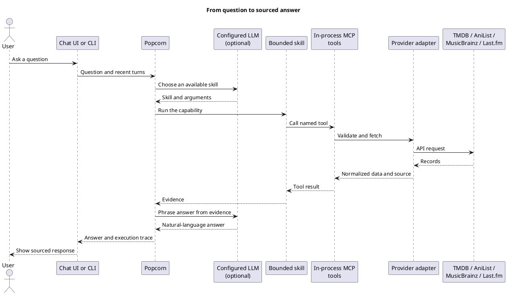
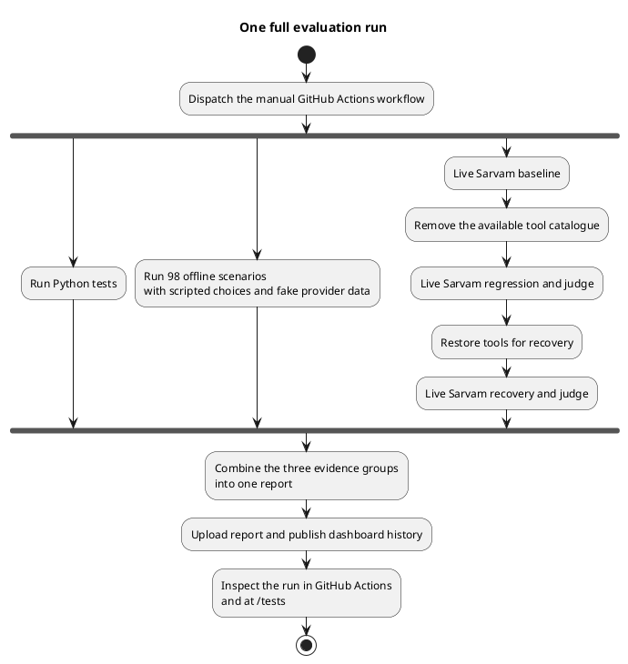

# Popcorn: Why evaluate an AI agent?

Popcorn is an entertainment discovery assistant. Popcorn Tasting is the separate project that checks how Popcorn behaves. Together they show a practical point about AI: a fluent answer can still be wrong, incomplete, or unsupported by anything the agent actually looked up.

The evaluation demo makes that gap visible. It combines ordinary Python tests, 98 repeatable offline scenarios, and a small live experiment in which a language model answers and a second model call judges the answer against the question and the evidence collected by the agent.

## The quick visual guide

> **The idea:** Don’t judge an AI agent by its wording alone. Check what it did, what evidence it found, and whether its answer used that evidence.

```text
PERSON'S QUESTION
       ↓
POPCORN chooses a bounded skill
       ↓
SKILL calls an MCP tool → provider returns sourced records
       ↓
ANSWER + execution trace
       ↓
POPCORN TASTING checks behavior and evidence
```

| 1 · Software checks | 2 · Repeatable scenarios | 3 · Live judge demo |
|---|---|---|
| **106 Python tests** check code behavior. | **98 offline scenarios** check skill/tool paths and expected outcomes using scripted choices and fake provider data. | **One live question** compares a normal answer, a tool-catalog regression, and recovery. |
| Catches broken components and interfaces. | Repeatable, credential-free, and not LLM-judged. | Sarvam answers; a separate Sarvam call scores grounding, completeness, and clarity. |

**The regression story**

`BASELINE  ✓ evidence retrieved`  →  `REGRESSION  ⚠ tools removed; answer from memory`  →  `DETECTED  ↓ judge score and expected tool checks`  →  `RECOVERY  ✓ tools restored`

In the latest full run, the regression lowered the live judge score by **1.07 points**. The dashboard and Actions artifacts let viewers inspect the answer, judge criteria, tool events, and test results behind that summary. The judge is a useful comparison signal, not an oracle; only this one live scenario is judged.

**Where to look:** GitHub Actions shows the workflow and downloadable reports. The hosted **`/tests`** dashboard brings Python test results, offline scenario traces, provider/tool coverage, and the live sequence together for inspection and comparison.

<details>
<summary>What this demo does not claim</summary>

The offline scenarios are not judged by an LLM. Game discovery and broad verified cross-provider links remain future work. Live model calls use paid quota, and provider coverage and availability affect results.

</details>

## A convincing answer can still be a failure

Suppose someone asks: “Tell me about the 2017 movie *Get Out*: when was it released, what genre is it, and name one cast member. Keep it concise and cite the source.”

An answer may sound confident while getting the date wrong, omitting the cast, or citing no source. It might even provide plausible details without searching for the movie at all. Reading only the final sentence does not reveal whether Popcorn selected the right capability or retrieved supporting evidence.

Popcorn records execution events alongside its response. The evaluator can therefore check two different things: whether the expected movie search and details tools ran, and whether the answer covered the requested facts and was supported by the observed TMDB result. That evidence gives a reviewer more to inspect than wording alone.

## How a request moves through Popcorn

Popcorn offers a bounded set of skills. When a model is configured, it selects from those skills and helps phrase the answer; provider access remains in Popcorn’s code. Without a model key, a deterministic router handles a narrower set of supported requests. Skills use Popcorn’s in-process MCP tools and provider adapters to retrieve records. Responses retain source links, and structured traces record the execution path.



The implemented slice covers selected movie and TV discovery, cast and person credits, related titles and collections, watch availability, explicit guest ratings, AniList anime and manga discovery, MusicBrainz artist and release discovery, and Last.fm seed-based music recommendations. This is not a complete entertainment catalogue. Game discovery and broader verified links across providers remain future work. Similar names alone do not establish that two records are related.

## What Popcorn Tasting checks

Popcorn Tasting runs separately from the agent. It calls Popcorn through a narrow adapter and keeps the results, checks, execution events, and coverage in a report.

The regular offline mode uses scripted model choices and deterministic fake provider responses. It still exercises Popcorn’s real orchestration, skills, in-process MCP path, and provider response handling. Its 98 scenarios cover supported requests, follow-ups, ambiguity, empty results, expected skill and tool use, deterministic assertions, and transparent phrase-based rubrics. This is repeatable evidence about software behavior, but it does not measure live model quality or provider availability. These 98 cases are not judged by an LLM.

The live judge demonstration is deliberately narrow. It uses one *Get Out* question, repeated three times for each version. Sarvam generates answers; a separate Sarvam call scores them against criteria for evidence grounding, completeness, and clarity. The judge sees the observed MCP evidence too. Expected skill and tool checks remain separate, so a semantic score cannot hide a missing tool call.

The demonstration changes the available tool catalogue to create a controlled regression: Popcorn is asked to answer from memory instead of retrieving evidence. Then it restores the normal catalogue for recovery. This shows how an answer can lose grounding when tool execution disappears, even if the prose remains plausible.



The workflow keeps three evidence groups distinct while collecting them in one report:

| Evidence | What it tells you | What it does not tell you |
|---|---|---|
| Python tests | Whether tested software units and interfaces pass | Whether a live model will choose a good answer |
| 98 offline scenarios | Whether scripted decisions travel through the expected skills, tools, and provider parsing | How live model phrasing or a live provider will behave |
| Live judge sequence | How one live answer compares with the evidence and rubric across baseline, regression, and recovery | That every answer is correct, or that all 98 scenarios have been judged |

## What viewers can inspect

GitHub Actions shows the workflow steps, overall result, run summary, and downloadable JSON artifacts. The `/tests` dashboard presents a full run with the exact Python test names and statuses, offline scenarios and their event sequences, skill/MCP/provider endpoint coverage, and the live responses, judge criteria, scores, and baseline/regression/recovery comparison. A run selector supports comparison with another saved run. The dashboard keeps up to ten reports on the `eval-history` branch because the hosted Render service has ephemeral storage.

The latest full evaluation run at the time this document was written completed successfully on 11 November 2026. It ran commit `edde43efd7dd08f81ee5942e3d384b23ad018238`: 106 of 106 Python tests passed, all 98 offline scenarios passed, and the live judge sequence passed its checks. The injected regression reduced the judge score by 1.07 points; the recovery run passed. This particular dispatch used live TMDB evidence. [Open the GitHub Actions run](https://github.com/dragondive/less-talk-more-github-actions/actions/runs/42964922160).

## How to run the demo

The ordinary local checks do not require provider credentials:

```bash
python -m pytest projects/popcorn/tests projects/popcorn_tasting/tests
python -m popcorn_tasting --mode fixture
```

For the combined dashboard report, manually dispatch **Popcorn Full Evaluation Demo** in GitHub Actions. It requires `SARVAM_API_KEY` for the live model and judge calls. The workflow defaults to fixture provider evidence, which keeps the agent’s model calls live while holding provider responses constant. Choose live TMDB evidence to include real TMDB requests; that option also needs `TMDB_ACCESS_TOKEN`. Model calls use paid API quota, and live provider data may vary.

## Limits to keep in view

- The 98 offline scenarios are not LLM-judged; their phrase-based rubrics are transparent checks over deterministic runs.
- The live judge is one bounded scenario, not a broad quality benchmark. A judge score is comparative evidence, not a guarantee of factual correctness. The judge call uses the same provider family by default, so it is not an independent adjudicator.
- Game discovery and broader verified cross-provider relationships are not implemented.
- Provider records can be incomplete or change. Live results depend on provider coverage, network availability, credentials, rate limits, and terms.
- Live model calls consume paid quota, and live model/provider behavior can vary between runs.

The useful lesson is not that one score settles whether an agent is good. It is that tests, repeatable scenarios, tool traces, and a bounded semantic judge answer different questions. Together they make a regression easier to notice, explain, and review.

## Further reading

- [Repository setup and product boundaries](../README.md)
- [Popcorn Tasting run modes and report details](../projects/popcorn_tasting/README.md)
- [Project context and current roadmap](../PROJECT_CONTEXT.md) · [ROADMAP.md](../ROADMAP.md)
